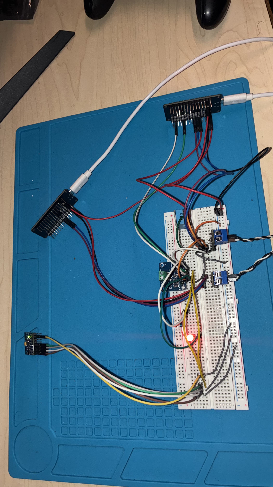

# ESP32 CAN Condition-Monitor Network

Two ESP32s exchange hardware temperature, motion, and electrical measurements
over a 500 kbit/s CAN bus. The sensor ECU reads a DHT11, an MPU6050, and an
INA219. The dashboard ECU decodes the frames, detects communication timeouts,
and exports CSV telemetry with sequence and boot-session metadata. The
condition percentage is a labeled simulation value.

## Validation

The regular v0.5.0 firmware passed a **10-minute hardware soak** with
**9,500 decoded telemetry records**, zero detected sequence gaps, zero
unavailable hardware readings, and zero communication timeouts or observed
restarts. Temperature, power, motion, and sequence checks were required.

| Stream | Records | Mean interval | Max interval |
| --- | ---: | ---: | ---: |
| Heartbeat | 600 | 1,000.377 ms | 1,013 ms |
| Condition | 2,968 | 202.171 ms | 217 ms |
| Motion/power | 5,932 | 101.140 ms | 116 ms |

The MPU stayed at 2–4 mg with the module still. In separate tests on the
bench firmware, the dashboard showed the motion value rise during gentle
rocking and return to its baseline. With only the MPU's SDA branch open at
startup, motion was marked unavailable while temperature, power, and CAN
telemetry continued. Motion returned to 3–5 mg after SDA was restored and
the boards rebooted. The detailed records include the capture warnings and
test limits. [Regular firmware soak](evidence/bench_results.md#2026-11-09--600-second-soak-on-regular-mpu6050-sensor-firmware)
· [Bench test history](evidence/bench_results.md)

## Hardware and architecture



The black-and-white twisted pair links the two SN65HVD230 CAN transceivers.
The INA219 measures the resistor-limited red LED branch. The MPU6050 is on
jumper leads so it can be tilted during the motion test. [Wiring guide](docs/WIRING.md)

```text
DHT11 temperature ──────┐
MPU6050 motion ──────────┼─ Sensor ESP32 ── CAN ── Dashboard ESP32 ── USB CSV
INA219 voltage/current ─┘   SN65HVD230            SN65HVD230
```

The sensor schedules CAN transmit bursts between shared I²C transactions.
Sensor validity fields distinguish fresh hardware measurements from
unavailable data. The motion value is the RMS variation of acceleration over
roughly one second, so changing tilt contributes to it. The host capture
tool checks observed cadence, availability, sequence gaps, duplicates, and
session changes. [Sequence tracking](docs/SEQUENCES.md)

## Quick start

1. Install PlatformIO and Python 3, then wire the boards according to the
   [wiring guide](docs/WIRING.md).
2. Build the regular sensor and dashboard firmware from the project directory.

   ```powershell
   platformio run -e esp32dev_sensor_dht11_ina219_mpu6050
   platformio run -e esp32dev_dashboard
   ```

3. Flash each build to the corresponding physical ESP32. Power the dashboard
   first, then the sensor, and identify the dashboard's current serial port.
   The dashboard serial monitor runs at 115200 baud.
4. Close the dashboard serial monitor before capturing. Replace `COM3` with
   your dashboard's port and run the capture with the MPU still.

   ```powershell
   py -m pip install pyserial
   py tools/capture_can.py --port COM3 --seconds 600 --require-hardware-temperature --require-hardware-power --require-hardware-motion --require-sequences
   ```

The capture saves a raw log, parsed CSV, and JSON summary in a local
`data/can-soak-*` directory. Git ignores these capture directories.
Run the host protocol and capture tests with
`py -m unittest discover -s tools -p "test_*.py" -v`.
Use `esp32dev_sensor_sim` for the simulation-only sensor build.

## CAN interface

The J1939-inspired identifier layout uses 29-bit extended IDs and eight-byte
payloads. CAN runs at 500 kbit/s, with ESP32 TX on GPIO17 and RX on GPIO16.

| Identifier | Message | Target interval |
| --- | --- | --- |
| `0x18FEFF01` | Boot-session marker | Before each due batch |
| `0x18FF0001` | Heartbeat | 1,000 ms |
| `0x18FF1001` | Condition and temperature | 200 ms |
| `0x18FF1101` | Motion, voltage, and current | 100 ms |

## Project notes

- [Requirements](docs/REQUIREMENTS.md), [project plan](docs/PROJECT_PLAN.md),
  and [test plan](docs/TEST_PLAN.md)
- [DHT11 integration](docs/DHT11.md),
  [INA219 bench checks](docs/INA219.md),
  [INA219 CAN integration](docs/INA219_CAN.md), and
  [MPU6050 bench checks](docs/MPU6050.md)

The SN65HVD230 uses 3.3 V. Power both boards off before changing wiring or
measuring termination resistance. The validation applies to this bench setup.

## License

All rights are reserved by the author.
